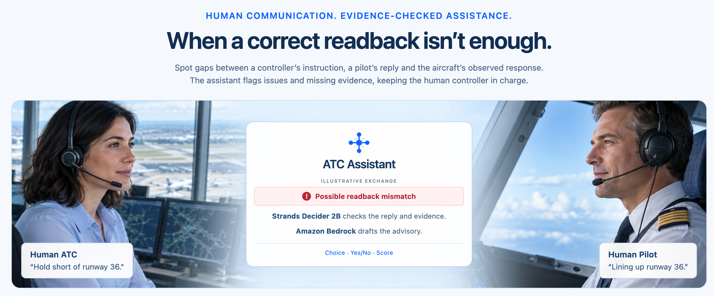

# Air Traffic Controller Assistant

**When a correct readback isn't enough.**

[](https://decider.ibercode.es/recorded)

[**Demo video**](https://www.youtube.com/watch?v=2uCB2KCBw-A) · [**Recorded Demo**](https://decider.ibercode.es/recorded) · [**Live Demo**](https://decider.ibercode.es/live) · [**Reusable Guardrails pattern**](patterns/cited-evidence-guard/README.md) · [**Run locally**](#run-locally)

What the controller said, what the pilot repeated, and what the aircraft did are three different pieces of evidence. This experimental assistant compares them in fictional airport scenarios, making communication mismatches and missing evidence visible. Amazon Bedrock proposes an explanation; **Strands Decider 2B checks whether its factual findings follow from their cited evidence before publication**.

The controller and pilot are fictional, scripted human roles. Choose a scenario and controller response, then start once: typed messages and aircraft actions advance automatically while you observe. Inspect the assistant's decisions and the evidence behind them; no manual radio input or spoken playback is used. A corrected readback does not prove that the aircraft complied, and stale observations leave the current physical outcome unverified. This is a simulation prototype, not an operational ATC system.

**Start with Recorded Demo:** no sign-in is needed. Its outputs and measured response times come from real previous Decider and Bedrock invocations, not mocked answers; playback makes no new model calls. Live Demo runs new inference and requires an invitation, Cognito login and MFA for judges or authorized testers.

The [demo video](https://www.youtube.com/watch?v=2uCB2KCBw-A) captures a new live **Incorrect readback → Correction only** run. The detailed Guardrails walkthrough below uses a separate **Words versus actions → Correction + observation** recording.

**Inspiration.** The project is inspired by real-world pilot–controller communication problems. [NASA ASRS CALLBACK (May 2000)](https://asrs.arc.nasa.gov/docs/cb/cb_251.pdf) documents misunderstood clearances and confusion between similar call signs. Our scenarios are fictional and do not reconstruct any specific incident; the recorded AI outputs and timings come from real model runs.

## A Guardrails example to explore

In [Recorded Demo](https://decider.ibercode.es/recorded), choose **Words versus actions → Correction + observation**, then **Play recording**. Watch the matching readback and the separate aircraft movement observation, then inspect the advisory checks in Activity:

| Near playback time | What to inspect |
| --- | --- |
| **00:48** | Bedrock proposes “The controller verified that AIR123 stopped before the holding point.” Its cited source says only “A controller verification check was recorded.” Decider returns `insufficient_evidence`, and the application withholds the proposed advisory. |
| **01:06** | After revision and further checks, the application publishes an advisory containing a supported finding and an observation step. |

The distinction is the **cited evidence**: recording that a check happened does not, by itself, establish its result. The full scenario contains other observation evidence; this rejection does not mean the aircraft failed to stop. You can inspect the finding, its source, the decision and the later publication in the [saved recording](recordings/public/v3/words-versus-actions-v3-complete.json), or reuse the same pattern in the [standalone delivery-status example](patterns/cited-evidence-guard/README.md).

## Real agent and decisions

**Reuse the Guardrails pattern:** [Cited evidence guard](patterns/cited-evidence-guard/README.md) includes a standalone Python client, a delivery-status example outside aviation, an offline request preview and tests, and instructions for real Decider inference. It uses the same Choice question as the application's advisory guard and requires no AWS deployment.

The Strands Agents SDK assistant uses Amazon Bedrock to select evidence-reading and feedback tools. It proposes short factual findings with source keys and a separate observation check. Source text is resolved by the backend from recorded evidence. The feedback tool calls **Strands Decider 2B** before publishing an explanation:

- **Choice:** instruction/readback alignment and whether each proposed factual finding follows from its cited source evidence.
- **Yes/No:** whether the scripted controller explicitly corrected the issue.
- **Score:** advisory completeness—whether the next step names aircraft data to inspect and a comparison/check to record, scored on that text alone.

The live monitor and generated explanation serve different purposes:

- **Communication:** the current comparison belongs to the latest controller instruction and pilot readback. A new instruction shows a pending check; uncertain or failed decisions stay unresolved. An older result remains in the issue history and cannot replace the latest comparison. A later explicit correction with a matching readback can resolve the communication issue only.
- **Aircraft response:** a separate card uses the simulator observation available to the assistant. It reports observed movement, a stopped aircraft or recorded runway entry. A stale observation shows the current position as unverified, without presenting historical coordinates as current.
- **Explanation:** Bedrock can propose a short advisory during the exchange and a final summary. Both use the cited-evidence guard. The monitor updates independently while an explanation is pending, and a published explanation is marked outdated if its relevant evidence changes. At replay completion, an existing advisory can serve as the final explanation if its evidence is still current; that reuse is recorded without another inference. Otherwise the assistant attempts a new final summary.

The simulator owns aircraft movement. Model outputs cannot move an aircraft or overwrite the event history. A failed request is recorded as an error; live mode never substitutes a scripted answer. Initial guard thresholds are experimental and require evaluation, not a claim of validated safety or accuracy. Inference time depends on the hardware, input and current workload; the demo does not promise a fixed response time or operational intervention.

## Public and live demos

The [landing page](https://decider.ibercode.es/) introduces the project with a controller–assistant–pilot illustration and two choices: **Recorded Demo** and **Live Demo**. The illustration uses AI-generated fictional people; its example alert is illustrative. Recorded and Live Demo reuse the same controller and pilot portraits. Both demo workspaces include a **Back to home** link.

The [Public Recorded Demo](https://decider.ibercode.es/recorded) lets anyone choose one of nine recorded scenario/response combinations and watch the original model decisions, alerts, activity and measured response times. The landing page and playback read static assets only: they do not call the API, Cognito, Decider or Bedrock. They remain available when the backend compute is stopped. Normal static hosting and delivery charges still apply.

[**Live Demo**](https://decider.ibercode.es/live) is reserved for invited AWS hackathon judges and authorized testers. Cognito login and MFA protect session access and new model inference. Judges can request an individual invitation by emailing [decider@ibercode.com](mailto:decider@ibercode.com). Live sessions are subject to compute availability; no public registration or shared credentials are provided.

The public catalog uses a clean replacement for Incorrect readback / Correction only. The first capture, including its recovered timeout, remains in `recordings/v3` as test evidence; the replacement is stored separately. Amber experimental model judgments in other cases are retained and are distinct from runtime errors.

## Run locally

For the static public demo, install frontend dependencies and start Vite; no backend or AWS login is needed:

```sh
npm --prefix frontend ci
npm --prefix frontend run dev -- --port 5174
```

Open `http://127.0.0.1:5174` and choose **Recorded Demo**, or visit `/recorded` directly. Select a scenario and controller response, then **Play recording**. Pause, restart and inspect activity without starting inference.

For live development, open `http://127.0.0.1:5174/live` after configuring the services below.

Requires Python 3.11+ for the API, Python 3.12 for the documented Mac Decider environment, Node.js 22.12+, an AWS profile with Bedrock inference access, and the public model downloads described in [the Decider setup](services/decider/README.md).

```sh
uv venv --python 3.11 backend/.venv
uv pip install --python backend/.venv/bin/python -e 'backend[dev]'
cp backend/.env.example backend/.env
cd frontend
npm ci
```

Edit the ignored `backend/.env` to enable real providers:

```dotenv
APP_ENV=development
AUTH_MODE=local
PROVIDER_MODE=live
STORAGE_MODE=sqlite
AWS_REGION=eu-west-1
AWS_PROFILE=your-configured-profile
DATABASE_PATH=../.data/clearance-gap-live.db
DECIDER_URL=http://127.0.0.1:8099
BEDROCK_MODEL_ID=eu.amazon.nova-pro-v1:0
```

`AWS_PROFILE` names a local profile; it is not a credential. Never put access keys or tokens in tracked files. The selected model/inference profile must be accessible to your account.

Start Decider using its setup guide. Then, in separate terminals:

```sh
cd backend
.venv/bin/uvicorn clearance_gap.api:create_app --factory --host 127.0.0.1 --port 8087
```

```sh
cd frontend
npm run dev -- --port 5174
```

Open `http://127.0.0.1:5174/live`. Start with **Incorrect readback / Correction only**. All messages advance automatically; Pause is available for inspecting the trace. Live model latency can extend the assistant's assessment after the scenario clock finishes.

New exercises use scenario version 3 with runway 36/18. Saved version 1 and 2 sessions retain their pinned scenario and runway 27/09; the map and assistant receive the setup from that session's definition.

For offline UI development, set `PROVIDER_MODE=fixture` and use a separate database. The banner identifies scripted fixtures. A saved session cannot be started or resumed under a different provider mode.

## Verify

```sh
backend/.venv/bin/pytest -q backend/tests
backend/.venv/bin/pytest -q scripts/tests
python3 -m unittest discover -s patterns/cited-evidence-guard -p 'test_*.py'
npm --prefix frontend test
npm --prefix frontend run build
python3 scripts/check_publication.py
# After staging, inspect exactly the files that the commit will contain:
python3 scripts/check_publication.py --staged
```

These checks do not invoke models or provision cloud resources. The publication check reports paths and categories without exposing matched values. Review binary metadata and run a dedicated secret scanner such as Gitleaks as well; a clean scan is a scoped review, not proof that arbitrary future edits are safe.

For explicitly requested live integration checks:

```sh
backend/.venv/bin/python scripts/test_live.py
# Three representative exercises, using paid Bedrock calls:
backend/.venv/bin/python scripts/test_live.py --all
```

The live check requires actual Decider answers and Bedrock token usage, successful guarded publication, and no runtime errors. Reports stay under ignored `.data/test-reports/`. Inspect report evidence to assess model quality; passing an integration check is not an accuracy benchmark.

The local app binds to loopback with a development identity. Real local testing uses Bedrock on demand and does not create ECS resources.

## License and publication scope

Original project code and documentation are licensed under [Apache 2.0](LICENSE), an [OSI-approved license](https://opensource.org/license/apache-2.0). See [NOTICE](NOTICE) and [third-party notices](THIRD_PARTY_NOTICES.md) for dependency, model and asset attribution. The browser build includes [third-party license texts](frontend/public/third-party-notices.txt). Dependencies and downloaded model weights retain their respective licenses.

This repository contains the application source, Terraform templates, fictional scenarios, sanitized real-inference recordings and the reusable pattern. Deployment credentials, personal configuration, Terraform state/plans, raw captures, local reports, caches and private planning notes are excluded. The configuration examples use placeholders. The original recording with recovered runtime errors is preserved in sanitized form; a clean retake is explicitly identified in the public catalog.

The public URL is the project's intended demo address. It is not an API credential. Configure your own domain, AWS account and private alert recipient when deploying a copy.

## Recorded demonstration data

The nine current combinations (three version 3 scenarios × three controller responses) can be captured once with real providers, then replayed without new inference. [The original recording manifest](recordings/v3/manifest.json) identifies the initial sanitized dataset and its per-file SHA-256 hashes. These are real model results on fictional scripted communications, not recordings of real aviation incidents. A recorded result is not a new model decision or an accuracy benchmark.

Start this read-only recorder before launching each case through the authenticated app, sequentially:

```sh
python3 scripts/record_replays.py --profile YOUR_CONFIGURED_PROFILE \
  --table YOUR_SESSION_TABLE --region eu-west-1 \
  --output .data/recordings/YOUR_NEW_BATCH --cases 9
```

The recorder uses the existing AWS CLI login; it never extracts browser credentials or starts inference. Raw records stay in ignored `.data/recordings/`, with restrictive permissions. `--resume` preserves completed files and appends to unfinished captures. Current recording uses strongly consistent META reads before and after the partition query and accepts only unchanged revisions. The exported provenance retains which consistency check each recording actually used.

After all nine complete, create a new sanitized directory and a separate test report:

```sh
backend/.venv/bin/python scripts/export_replays.py \
  --input .data/recordings/YOUR_NEW_BATCH --output recordings/YOUR_NEW_DATASET \
  --require-complete-matrix
python3 scripts/check_recordings.py .data/recordings/YOUR_NEW_BATCH \
  --output .data/recordings/YOUR_NEW_BATCH/checks.json
backend/.venv/bin/pytest -q scripts/tests/test_replay_tools.py
```

Exports preserve observed pending/completed states, decision outputs, evidence references, actual timings, token usage and failures. IDs are remapped consistently; owner/infrastructure identifiers and raw exception details are removed. Top-level session fields are allowlisted and nested payloads are redacted and checked. Review new arbitrary payload fields before publishing another dataset. Hidden simulator state is excluded; stale observed positions remain explicitly unverified.

Frames are sampled persisted revisions, not a continuous screen recording. Their `elapsedMs` values use wall-clock time; `simulationTimeMs` may stop while final assessment continues. Short transitions between polls may be absent, and each bundle reports capture gaps and missing starts. Do not invent missing observations or erase errors when constructing playback. Original `providerMode: live` describes the captured run; a public player must display **Recorded demonstration — no new inference**, with metrics identified as measurements from that recording. The recorded player and the authenticated Live Demo must have separate startup paths so public playback never needs `/api/*`, Cognito or running inference services.

The shipped player loads the derived [public catalog](recordings/public/v3/manifest.json). Its [timeline contract](recordings/public/README.md) explains how recorded event/start/end times reconstruct short-lived alerts without changing the decisions. Generate a new catalog from sanitized sources, optionally selecting a separately captured retake:

```sh
backend/.venv/bin/python scripts/build_replay_timeline.py \
  --input recordings/v3 --replace-from recordings/retake-partial-20261017 \
  --output recordings/YOUR_NEW_PUBLIC_CATALOG
```

The generator refuses to overwrite its source or output directory. The frontend uses content-hashed URLs for each recording and downloads only the selected case. Original timestamps and RTTs remain unchanged at every playback speed; cumulative token usage advances only at original capture samples.

## Deploy to AWS

Terraform provisions the application in **eu-west-1**: a private S3 UI behind CloudFront, HTTPS through an Application Load Balancer, separate ARM64 Fargate API and Decider services, Cognito, DynamoDB and versioned scenario storage. The CloudFront certificate is in **us-east-1**, as required for that global service. The regional origin certificate remains in eu-west-1.

Use Terraform 1.10+, AWS CLI v2, Docker Buildx, an existing public Route 53 zone, and an AWS profile authorized to deploy the resources and invoke the selected Bedrock model. The default assistant uses the EU Nova Pro inference profile; Bedrock may route inference within the EU.

The wrapper exports credentials from the named AWS CLI profile into the Terraform subprocess environment. Credentials are held in memory, never written to configuration. Refresh the profile's login before deployment. **Leave `aws_profile` unset and omit `profile` from backend configuration when using the wrapper.**

```sh
export CG_AWS_PROFILE=YOUR_CONFIGURED_PROFILE
cd infrastructure/bootstrap
python ../../scripts/terraform_with_profile.py --profile "$CG_AWS_PROFILE" init
python ../../scripts/terraform_with_profile.py --profile "$CG_AWS_PROFILE" plan -out=bootstrap.tfplan
python ../../scripts/terraform_with_profile.py --profile "$CG_AWS_PROFILE" apply bootstrap.tfplan
python ../../scripts/terraform_with_profile.py --profile "$CG_AWS_PROFILE" output -raw state_bucket
```

Bootstrap creates an encrypted, private, versioned state bucket with deletion protection. Keep its local bootstrap state backed up privately. In `infrastructure/terraform`, copy `terraform.tfvars.example` to ignored `terraform.tfvars`, fill in your domain and alert email, and add `auto_stop_at`: an explicit UTC shutdown time in `YYYY-MM-DDTHH:MM:SS` format, without `Z`. For a 72-hour demo, set it to 72 hours after deployment begins. Keep `desired_count = 0` initially.

Create ignored `infrastructure/terraform/backend.hcl` using the bucket output:

```hcl
bucket       = "YOUR_BOOTSTRAP_STATE_BUCKET"
key          = "clearance-gap/terraform.tfstate"
region       = "eu-west-1"
encrypt      = true
use_lockfile = true
```

```sh
cd ../terraform
python ../../scripts/terraform_with_profile.py --profile "$CG_AWS_PROFILE" init -backend-config=backend.hcl
python ../../scripts/terraform_with_profile.py --profile "$CG_AWS_PROFILE" plan -out=deploy.tfplan
python ../../scripts/terraform_with_profile.py --profile "$CG_AWS_PROFILE" apply deploy.tfplan
python ../../scripts/terraform_with_profile.py --profile "$CG_AWS_PROFILE" output
```

Complete deployment in this order:

1. Build both Linux ARM64 images using [the container instructions](services/decider/README.md#linux-arm64-containers). Authenticate Docker to the ECR registry with `aws --profile "$CG_AWS_PROFILE" ecr get-login-password --region eu-west-1` piped into `docker login --username AWS --password-stdin`. Tag and push each image to its `ecr_repositories` output using a new immutable tag.
2. Read each pushed image's `imageDigest` with ECR `describe-images`. Set `api_image_digest` and `decider_image_digest` to those `sha256:…` values in private `terraform.tfvars`, set `desired_count = 1`, then create and apply a fresh Terraform plan. Startup requires both digests and a future shutdown time.
3. Build the frontend with `npm --prefix frontend ci` and `npm --prefix frontend run build` from the repository root. Upload `frontend/dist/` to the `ui_bucket` output using `aws s3 sync`. Use `no-cache` for `index.html` and long-lived caching for hashed `assets/`. Invalidate CloudFront after updates with `aws cloudfront create-invalidation --distribution-id YOUR_DISTRIBUTION_ID --paths '/*'`; use the configured CLI profile for both commands.
4. Wait for ECS services and CloudFront to become ready. Create individual Cognito users through the administrator invitation flow. Users set their own password and enroll an authenticator app at first login. Keep invitations and user details outside the repository and Terraform configuration.

Terraform state, plans, private backend configuration, `.tfvars`, credentials, local reports and model caches are Git-ignored. State contains sensitive origin configuration; retain it only in the private state bucket and protected local files.

## Access and cloud verification

The recorded public page is anonymous. The separate Live Demo and all session APIs require authentication; self-registration is disabled. Cognito requires authenticator MFA, and the browser uses authorization code flow with PKCE. The API validates the access token's issuer, client, expiry and scope, and restricts sessions to their owner. Each user can start or resume at most **20 exercises per UTC day**, and only **one exercise** can run or be assessed at a time. Idempotent retries do not consume another run.

CloudFront is the public entry point. Its HTTPS origin uses a secret header and restricted security group; the Decider port accepts traffic only from the API security group. S3 buckets block public access. The API runs as one process and one task; increasing either requires a shared coordination design.

Before admitting users, launch a one-off ECS task using the deployed API task definition, task role and network configuration, overriding its command to:

```sh
python -m clearance_gap.cloud_smoke --timeout 600
```

Inspect its exit code and JSON result in CloudWatch. This paid check exercises the versioned S3 scenario, DynamoDB writes and reload, real Decider capabilities, Bedrock token usage and guarded feedback. It leaves a synthetic session as deployment evidence. It bypasses HTTP authentication, so separately verify that unauthenticated session requests return 401, then test the Cognito login/MFA flow and an exercise in the browser. Run the smoke task before interactive use because it has its own coordinator.

## Cost and shutdown

The initial ARM64 sizing is 4 vCPU/16 GiB for Decider and 0.25 vCPU/0.5 GiB for the API. Decider's CPU runtime uses float32 weights; the memory allocation also allows for loading and inference overhead. Reduce it only after measuring peak usage. At the checked Ireland rates, 72 hours of these tasks, the ALB and minimum public IPv4 allocation costs approximately **$17.39**, before Bedrock, storage, logging and traffic. Rates are available in the official [Fargate regional catalog](https://pricing.us-east-1.amazonaws.com/offers/v1.0/aws/AmazonECS/current/eu-west-1/index.json), [ALB regional catalog](https://pricing.us-east-1.amazonaws.com/offers/v1.0/aws/AWSELB/current/eu-west-1/index.json) and [IPv4 pricing](https://aws.amazon.com/vpc/pricing/).

The **$100 monthly AWS Budget is account-wide**: it includes untagged Bedrock charges and other projects in the account. With an alert email configured, notifications fire above 50%, 80% and 100%. Billing data is delayed; this is an alert, **not a hard spending cap**.

EventBridge Scheduler sets both ECS services to zero at `auto_stop_at`. It does not restart them. The ALB and its public IPv4 addresses continue to cost approximately **$0.845/day**, plus storage and other usage, after the tasks stop.

- **Stop early:** set `desired_count = 0` in private variables, create a new plan and apply it. Verify both services reach zero running tasks.
- **Resume:** review the remaining budget, set a new future `auto_stop_at`, retain the image digests, set `desired_count = 1`, then plan and apply. An expired shutdown time blocks startup; there is no automatic restart after the scheduled stop.
- **Finish the demo:** set `desired_count = 0`, then review and apply a destroy plan for `infrastructure/terraform`. Export anything you need first: this removes application resources and data. Nonempty versioned S3 buckets and ECR repositories require deliberate cleanup before deletion. Keep the separate bootstrap state bucket and its state until cleanup is verified; its deletion protection is intentional. Stopping ECS alone does not end all charges.
